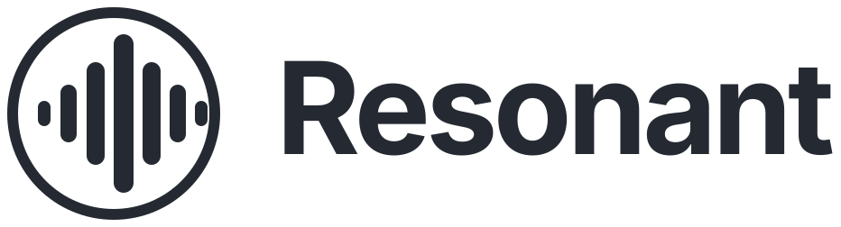
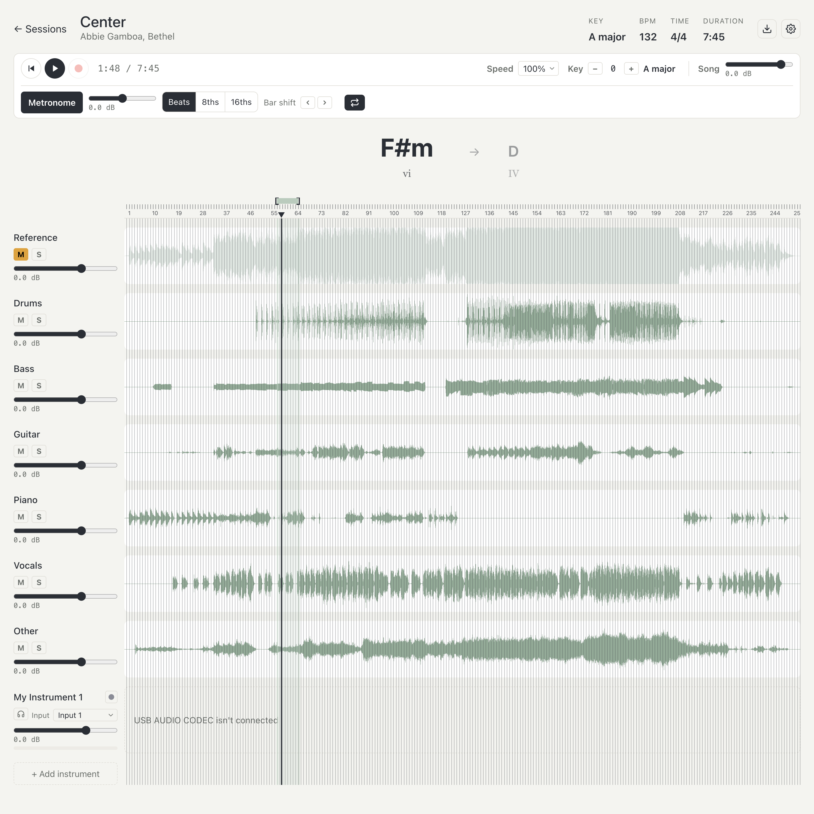
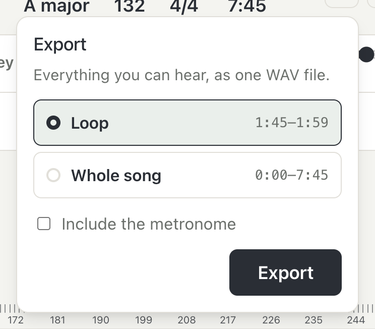
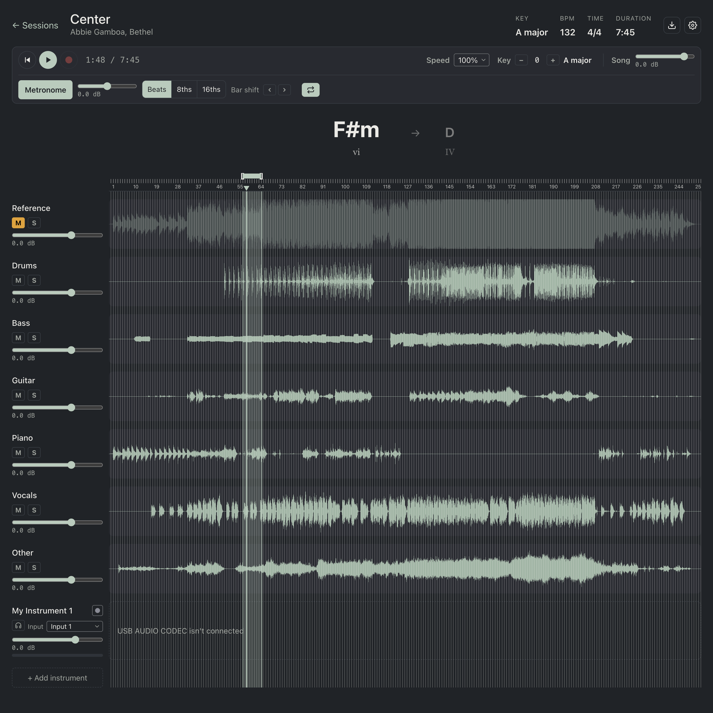

<p align="center">
  <picture>
    <source media="(prefers-color-scheme: dark)" srcset="Assets/resonant-logo-dark.svg">
    
  </picture>
</p>

<p align="center">
  A desktop practice app for musicians. Drop in any song, split it into its instruments,<br>
  and play along with your own part through your audio interface.
</p>



## What it does

Load a song and Resonant separates it into six stems: **drums, bass, guitar, piano, vocals and other**. Mute
the part you play, then play it yourself along with the rest of the band.

- **Mix the band.** Mute, solo or change the level of each instrument.
- **Chords, key and tempo.** It finds the key, tempo and beat grid, then shows the current and next chord
  as you play, with the chord's number in the key (I, IV, vi…).
- **Slow it down or change the key.** Play at 50% to 125% speed without changing the pitch, or move the
  song up or down by as much as 6 semitones.
- **Metronome that follows the song.** Clicks on the song's real beats, not a fixed tempo, in beats,
  8ths or 16ths.
- **Loop a section.** Drag a region along the top of the timeline and it repeats until you stop.
- **Hear yourself through the app.** Plug your instrument into an audio interface and Resonant plays
  it back with the song in real time, in mono or stereo.
- **Record takes.** Record yourself over the song, or over a loop where each pass becomes its own take,
  then pick your best one.
- **Recording sync.** A one-time loopback test measures your interface's delay so takes line up
  exactly with the song.
- **Export.** Save what you hear (the band, your take and, if you want, the click) as a WAV file.
- **Private.** Everything runs on your Mac. No account, no uploads.

<p align="center">
  
</p>

## Why a C++ audio engine

To play along properly you need to hear your instrument the moment you play it. A browser's audio
system (which Electron uses) adds tens of milliseconds between your interface's input and output.
That's enough to feel late.

So the live part of the app is a small **C++ engine built on CoreAudio**, the Mac's native audio
system. It runs in its own process and passes your USB interface's input straight to its output, with a
round trip of around 10 ms at a 64-sample buffer. It also records takes. The backing tracks and
metronome stay in Web Audio, where timing is less critical.

## How it works

1. **Import.** The song is converted to a WAV file and analysed for tempo, beats and key (Essentia).
2. **Split.** Demucs, a machine learning model, separates it into six stems. Chordino finds the chords.
3. **Practice.** The player plays the stems with Web Audio. Speed changes happen live. Key changes are
   rendered in the background with Rubber Band.
4. **Play and record.** The C++ engine handles your interface: live monitoring and recording takes.



## Built with

| Part | Technology |
|---|---|
| App | Electron, React, Vite |
| Playback, speed, metronome, export | Web Audio API, AudioWorklet, Rubber Band (WebAssembly) |
| Live monitoring and recording | C++ (CoreAudio), Node-API addon |
| Stem separation | Python, PyTorch, Demucs (`htdemucs_6s`) |
| Tempo, beats and key | Essentia |
| Chords | Chordino (Vamp plugin, built from source) |
| Key changes | ffmpeg with Rubber Band |
| Tests | Vitest, Python `unittest` |

## Requirements

- **macOS** (the audio engine uses CoreAudio). Developed on an Intel Mac.
- **Xcode command line tools** to build the C++ parts: `xcode-select --install`
- **Node.js** 20 or newer
- **Python** 3.10 or 3.11
- **ffmpeg** with Rubber Band, for key changes. Homebrew's has it: `brew install ffmpeg`
- An **audio interface** for monitoring and recording. Everything else works without one.

Python packages are listed in [`processing/requirements.txt`](processing/requirements.txt) and
JavaScript packages in [`package.json`](package.json). The setup script installs both.

## Getting started

```bash
npm run setup   # installs packages and builds the audio engine and chord detection (one time)
npm run dev     # starts the app
```

Setup downloads PyTorch and Demucs, so the first run takes a while. Splitting a song takes a few
minutes, depending on your Mac.

Other commands: `npm test` (JavaScript tests), `npm run lint`, `npm run build`, and
`processing/.venv/bin/python -m unittest discover processing` (Python tests).

## Project layout

| Folder | What's in it |
|---|---|
| `src/main/` | Electron main process: sessions, processing jobs, recording, export |
| `src/preload/` | The bridge between the UI and the main process |
| `src/renderer/` | React UI and the Web Audio player |
| `src/shared/` | Code used by both sides (validation, timing maths) |
| `native/audio-engine/` | C++ CoreAudio engine for monitoring and recording |
| `native/chordino/` | Chord detection tool (Chordino, built from source) |
| `processing/` | Python: analysis and stem separation |

## Credits

Stem separation by [Demucs](https://github.com/facebookresearch/demucs) (MIT). Chord detection by
[Chordino / NNLS Chroma](https://github.com/c4dm/nnls-chroma) (GPL). Time stretching and pitch shifting by
[Rubber Band](https://breakfastquay.com/rubberband/) (GPL). Audio analysis by
[Essentia](https://essentia.upf.edu/) (AGPL).
